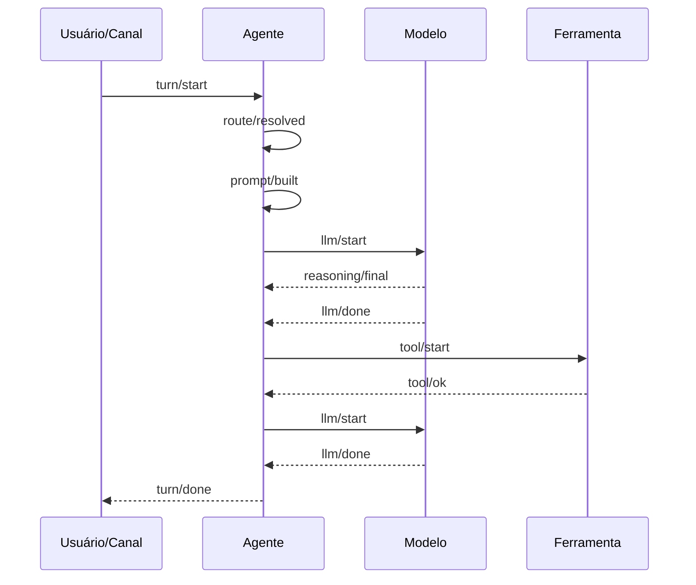

<!-- Gerado por `nickel audit docs` a partir de nickel/core/events.py. Não edite à mão. -->

# Fluxo de um turno

Sequência esperada de eventos num turno normal com uma chamada de ferramenta.
Cada seta corresponde a um evento `kind/status` de `TURN_FLOW`.

## Etapas

1. `turn/start`: Ciclo completo de um turno de conversa.
2. `route/resolved`: Resolução da rota (workspace/skill) de um turno.
3. `prompt/built`: Montagem do prompt enviado ao modelo.
4. `llm/start`: Chamadas ao modelo de linguagem.
5. `reasoning/final`: Raciocínio do modelo, parcial e final.
6. `llm/done`: Chamadas ao modelo de linguagem.
7. `tool/start`: Execução de ferramentas pelo agente.
8. `tool/ok`: Execução de ferramentas pelo agente.
9. `llm/start`: Chamadas ao modelo de linguagem.
10. `llm/done`: Chamadas ao modelo de linguagem.
11. `turn/done`: Ciclo completo de um turno de conversa.
